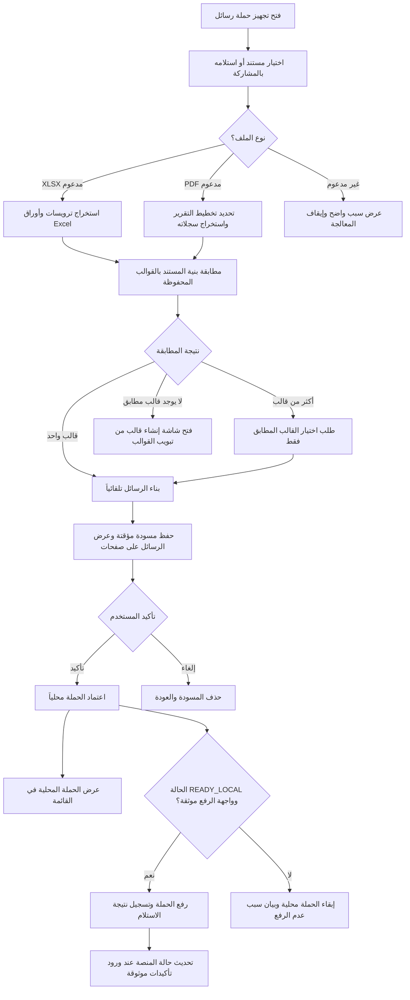

# خطة تبويب تجهيز حملة رسائل

**الحالة:** وثيقة تخطيط ومراجعة، وليست ادعاءً باكتمال التنفيذ  
**النطاق:** استلام مستند، استخراج البيانات، تطبيق قالب محفوظ، مراجعة الرسائل، حفظ الحملة محلياً، ثم رفعها إلى المنصة عند توفر واجهة موثقة  
**الميزة الجديدة:** تطبيق تقنيات الذكاء الاصطناعي المحلي (Smart AI) لاكتشاف تلقائي واقتراحات ذكية.
**قيد حالي:** لا يوجد مسار API موثق لرفع الحملة أو إرسال الرسائل؛ لذلك يظل الرفع والإرسال معطلين حتى توفير العقد المطلوب.

---

## 13. الميزات الذكية (Smart AI Features)

### 13.1 الاكتشاف التلقائي للأعمدة (Auto Column Detection)

عند استخراج ملف Excel/PDF، يحلل التطبيق كل عمود ويصنفه تلقائياً:

| نوع العمود | معايير الكشف | مثال |
|---|---|---|
| رقم الهاتف | يبدأ بـ + أو 00 أو 0، أرقام فقط، 7-15 رقماً | +966501234567 |
| اسم | يتطابق مع: name, fname, first_name, customer_name, اسم | اسم_العميل |
| مبلغ | أرقام مع أو بدون نقاط عشرية، قد يحتوي عملة | 1500.00 |
| تاريخ | يتطابق مع أنماط التاريخ الشائعة | 2024-01-15 |
| نص رسالة | نص عربي/إنجليزي طويل (20+ حرف) | رسالة تهنئة |

**النتيجة:** اقتراح تلقائي لعمود الهاتف وعمود الرسالة مع عرض نسبة الثقة.

### 13.2 اقتراح القالب التلقائي (Auto Template Suggestion)

عند تحليل ملف الحملة، يقترح التطبيق القالب المناسب:

```
المدخل: هيكل الملف (الأعمدة + أنواعها)
المعالجة:
  1. استخرج متغيرات كل قالب متاح
  2. قارن مع أعمدة الملف:
     - تطابق تام (Name == name) → 100 نقطة
     - تطابق جزئي (Name ~= customer_name) → 70 نقطة
  3. أضف وزن الاستخدام السابق (+20 نقطة للقوالب المستخدمة)
  4. رتب النتائج وأعرض أفضل 3 اقتراحات

المخرج: قائمة قوالب مقترحة مع نسبة الثقة لكل منها
```

### 13.3 الربط التلقائي للمتغيرات (Auto Variable Linking)

بعد اختيار القالب، يقترح التطبيق ربط كل متغير بعمود:

```
قالب: "مرحباً {{Name}}، مستحق مبلغ {{Amount}} ريال"
أعمدة الملف: [customer_name, amount_due, phone, notes]

الاقتراح:
- {{Name}} → customer_name (ثقة 85%)
- {{Amount}} → amount_due (ثقة 90%)
```

### 13.4 التحليل الذكي للرسائل (Smart Message Analysis)

قبل اعتماد الحملة، يحلل جميع الرسائل ويكشف:

| المشكلة | الوصف | الإجراء المقترح |
|---|---|---|
| قيمة ناقصة | متغير بلا قيمة في الصف | اقتراح قيمة شائعة أو افتراضية |
| رقم غير صالح | لا يتبع صيغة الهواتف | إظهار والتحذير |
| نص فارغ | رسالة أقل من 3 أحرف | استبعاد مع توضيح |
| نص طويل | أكثر من 600 حرف | تحذير من التقسيم |
| تكرار | نفس الرقم يتكرر | عرض قائمة التكرارات |

### 13.5 التحذيرات الاستباقية (Proactive Warnings)

قبل إرسال الحملة:

- **دفعة كبيرة:** إذا كان العدد > 1000 رسالة
- **أرقام مكررة:** عرض قائمة الأرقام المتكررة
- **رسائل فارغة:** تحذير مع عدد الرسائل الفارغة
- **نسبة نجاح منخفضة:** إذا كانت > 20% رسائل تحتاج مراجعة

### 13.6 التعلم من التفضيلات (Preference Learning)

يحفظ التطبيق قرارات المستخدم السابقة:
- القوالب الأكثر استخداماً
- الأعمدة المختارة لكل نوع ملف
- قيم افتراضية وافق عليها المستخدم

**الاستخدام:** تحسين الاقتراحات المستقبلية لنفس المستخدم.

---

**ملاحظة:** كل ميزات الذكاء الاصطناعي تعمل محلياً على الهاتف ولا ترسل أي بيانات للخادم.

## 1. الهدف

يبدأ المستخدم من تبويب **تجهيز حملة رسائل** باختيار المستند الذي يحتوي بيانات الحملة أو مشاركته مع التطبيق. يتولى التطبيق بعد ذلك:

1. التعرف على نوع الملف وبنية البيانات.
2. العثور على القالب المحفوظ المطابق للمستند وحقوله، دون مطالبة المستخدم بإعداد القالب أثناء إنشاء الحملة.
3. استخراج رقم كل مستلم والحقول المرتبطة به، وبناء رسالته من نص القالب.
4. عرض الرسائل الناتجة كمعاينة حملة قابلة للمراجعة.
5. حفظ الحملة محلياً بعد تأكيد المستخدم.
6. رفع الحملة إلى الموقع المرتبط بالتطبيق بعد نجاح الحفظ، عندما توفر المنصة مساراً موثقاً لذلك. رفع بيانات الحملة إلى الموقع لا يعني بالضرورة إرسال رسائل SMS إلى المستلمين؛ هاتان عمليتان منفصلتان.

تظل شاشة إدارة القوالب وإنشاءها عملية منفصلة. استخدامها يسبق تجهيز الحملة؛ ولا ينبغي أن تتحول شاشة الحملة إلى شاشة ربط أعمدة أو إنشاء قالب.

## 2. تدفق المستخدم المطلوب



**المبدأ الأساسي:** اختيار المستند هو بداية العملية؛ المطابقة والاستخراج وإنشاء المعاينة خطوات تلقائية بعدها. لا يُطلب إعداد القالب أو اختيار حقوله في كل حملة.

## 3. النطاق والحدود الوظيفية

### ضمن النطاق

- اختيار ملف من خلال Android Storage Access Framework، أو استقبال URI لملف واحد مشارك من تطبيق آخر، دون نسخ الملف إلى مجلد عام.
- مطابقة المستند مع قالب موجود بالاعتماد على مخطط حقول صريح.
- دعم صيغ المستندات التي لها محلّل موثق ومختبر فقط؛ XLSX هو أولوية التنفيذ، وPDF لا يدعم إلا بعد إنجاز محلل واختباره لكل تخطيط.
- إنشاء سجل رسالة لكل مستلم، مع الاحتفاظ برقم الصف أو الصفحة/السجل الأصلي.
- إظهار الرسائل والأرقام وحالة التحقق قبل الحفظ.
- حفظ الحملة والرسائل في قاعدة البيانات المحلية، ثم إظهارها في قائمة الحملات.
- رفع الحملة المحفوظة محلياً إلى المنصة بعد توفر API موثق، مع تسجيل قبول الخادم بمعزل عن حالة إرسال SMS.
- مراجعة جميع الرسائل على صفحات، مع إبراز السجلات التي تحتاج مراجعة قبل اعتماد الحملة.
- تعديل الرسالة أو حذف سجل فردي ليس جزءاً من النسخة الأولى؛ يعاد تجهيز الحملة بعد تصحيح المستند أو القالب.

### غير متاح حالياً حتى توفير عقد منصة صالح

- رفع الحملة إلى الخادم؛ لا يوجد حالياً مسار كتابة موثق لاستقبالها.
- إرسال رسائل SMS إلى المستلمين، أو وصفها بأنها «أُرسلت».
- إعادة المحاولة أو تأكيد التسليم أو ضبط حالات `SENT` و`FAILED` قبل توثيق واجهات الإرسال وحالة التسليم.

يجب أن تميّز الحالة بين **الحفظ المحلي** و**قبول المنصة للحملة** و**إرسال رسائل SMS** و**تسليمها**. لا يجوز استنتاج إحداها من الأخرى. راجع [ملاحظات الاتصال بالمنصة](./API-CONNECTION-NOTES.md).

## 4. المتطلبات الوظيفية

| المعرّف | المتطلب |
|---|---|
| FR-01 | تتيح الشاشة اختيار مستند من منتقي Android أو استقبال مستند واحد مشارك عبر URI؛ ولا تعرض أدوات إعداد القالب ضمن مسار إنشاء الحملة. |
| FR-02 | يقبل التطبيق الصيغ التي لها محلّل مكتمل فقط. عدم وجود قالب مطابق لصيغة مدعومة يفتح مسار إنشاء القالب؛ أما الصيغة غير المدعومة فتُرفض برسالة واضحة ولا تُوجّه إلى إنشاء قالب غير قابل للاستخدام. |
| FR-03 | يكتشف التطبيق بنية المستند، ويستخرج سجلات المستلمين، ويبني رسالة لكل رقم هاتف من الحقول المرتبطة به وفق القالب المطابق. |
| FR-04 | إذا وجد قالباً مطابقاً واحداً، ينشئ المعاينة تلقائياً. إذا وجد عدة قوالب مطابقة، يطلب اختياراً بينها فقط. |
| FR-05 | إذا لم يوجد قالب مطابق لصيغة مدعومة، لا ينتج رسائل بقالب قريب أو افتراضي؛ يوضح الحقول غير المتطابقة ويفتح شاشة إنشاء قالب مرتبطة بتبويب القوالب. بعد حفظ القالب، يعود لمسار الحملة ويعيد المطابقة للمستند نفسه. |
| FR-06 | يستخرج رقم الهاتف من حقل المستلم المحدد في القالب. يمكن استخدام الحقل نفسه داخل نص الرسالة كمتغير، ولا يعني ذلك استبدال رقم المستلم بنص الرسالة. |
| FR-07 | يستبدل متغيرات الرسالة بقيم السجل، ويكشف المتغيرات غير المرتبطة أو الخالية قبل تأكيد الحملة. |
| FR-08 | تعرض المعاينة رقم المستلم، نص الرسالة الناتج، مصدر السجل، وأخطاء التحقق. |
| FR-09 | يعرض التطبيق عدد الرسائل الصالحة وتلك التي تحتاج مراجعة، ويمنع اعتماد حملة فارغة أو حملة لا تملك أرقام مستلمين قابلة للاستخدام. |
| FR-10 | لا تُعتمد حملة نهائية قبل تأكيد المستخدم. يمكن تخزين مسودة مراجعة مؤقتة؛ إلغاؤها يحذفها هي ورسائلها، ولا يترك حملة جزئية ظاهرة في قائمة الحملات. |
| FR-11 | بعد التأكيد، تحفظ الحملة ورسائلها محلياً وتظهر في قائمة الحملات بحالة محلية صريحة، بصرف النظر عن توفر الاتصال بالمنصة. |
| FR-12 | تغيير الملف أو القالب يبطل المعاينة السابقة؛ يمنع تأكيد معاينة بنيت من مدخلات قديمة. |
| FR-13 | عند توفر عقد API موثق، وبعد موافقة المستخدم، يرفع التطبيق الحملة المحفوظة بحالة `READY_LOCAL` ويسجل نتيجة الرفع ومعرفها لدى المنصة؛ لا يرفع حملة `NEEDS_REVIEW`، ولا يؤدي فشل الرفع إلى فقدان الحملة المحلية أو تكرارها بصمت. |
| FR-14 | يعرض التطبيق عدد المستلمين، وعدد رسائل SMS المتوقع/المعتمد وفق قواعد تقسيم المنصة، كلّاً على حدة. لا يُحسب عدد الأجزاء بمجرد افتراض أن كل نص رسالة جزء واحد. |
| FR-15 | يعرض تاريخ ووقت الإرسال وحالات الإرسال والتسليم فقط من مصدر موثوق: موعد مجدول أو طابع زمني مؤكد من المنصة، وحالات/إحصاءات مستلمة من API أو تقرير حالة موثق. |

## 5. القالب وبيانات الحملة

القالب يحدد كيفية تحويل حقول المستند إلى رسالة؛ لا يُنشئ المستخدم القالب من جديد عند كل حملة. يفحص التطبيق مخطط المستند، ويطابقه مع القوالب المحفوظة، ثم يستخدم القالب المطابق لبناء رسالة مرتبطة بكل مستلم.

تتكون بيانات الحملة من مستويين:

### بيانات الحملة

- معرّف الحملة المحلي، واسمها، واسم/مرجع المستند المصدر.
- معرّف القالب واسمه وإصدار مخططه المستخدم في التجهيز.
- حالة الحملة المحلية، وحالة رفعها إلى المنصة في حقل مستقل إن أصبح الرفع متاحاً.
- عدد المستلمين، وعدد الرسائل التي تم إنشاؤها (سجل رسالة لكل مستلم)، وعدد الصالح منها وما يحتاج مراجعة.
- عدد أجزاء SMS المتوقع أو المؤكد، مع توضيح مصدر الرقم وقواعد التقسيم المستخدمة.
- وقت إنشاء الحملة ووقت رفعها. أما موعد الإرسال أو وقت الإرسال الفعلي فيحفظ فقط إذا توفر موعد مجدول أو تأكيد موثوق من المنصة.
- ملخص حالات الرسائل المستلمة/الفاشلة، ويُشتق من حالات الرسائل الفردية المؤكدة لا من افتراض محلي.

### بيانات كل رسالة

- رقم المستلم ونص الرسالة النهائي ومصدر السجل في المستند.
- حالة التحقق المحلية.
- حالة الرفع/الإرسال/التسليم ومعرف الرسالة لدى المنصة والطوابع الزمنية، عند ورودها من عقد موثق.
- عدد أجزاء SMS لا يُستنتج من عدد المستلمين: رسالة واحدة طويلة قد تُجزأ إلى عدة أجزاء، وقد تختلف الحدود باختلاف الترميز وسياسة مزود الخدمة. تعتمد القيمة على خوارزمية موثقة أو استجابة المنصة.

يحفظ التطبيق بيانات الحملة محلياً أولاً. لا ينشئ أوقات إرسال أو أعداد تسليم/فشل تخمينية، ويفصل بين «تم رفع الحملة» و«قبلت المنصة الإرسال» و«تم التسليم».

يجب أن تكون المطابقة **محددة وكاملة**: لا يعتبر وجود عمود الهاتف وحده دليلاً على صلاحية القالب إذا كانت أعمدة المتغيرات اللازمة للرسالة مفقودة. يجب ألا يختار التطبيق القالب «الأقرب» بصمت.

التخزين الحالي للقالب يحتوي اسم الهاتف وخريطة متغيرات بصيغة JSON، لكنه لا يعبّر بالكامل عن هوية تخطيط المصدر أو إصدار المخطط. يلزم اعتماد مخطط توافق واضح قبل اعتبار المطابقة التلقائية مكتملة، مع ترحيل قاعدة بيانات محافظ إن أضيفت حقول جديدة.

للكفاءة، تُقرأ بنية المصنف مرة واحدة لاستخراج مخطط الأوراق، ثم تُطابق المخططات مع القوالب في الذاكرة. بعد تحديد قالب واحد، يعاد فتح URI مرة واحدة لاستخراج الرسائل؛ وإذا تعددت القوالب، يتم ذلك بعد اختيار المستخدم. لا يُعاد تحليل الملف كاملاً مرة لكل قالب محفوظ.

## 6. متطلبات استخراج المستندات

### 6.1 Excel بصيغة XLSX

- القراءة باستخدام Apache POI event/SAX (`XSSFReader`)، وعدم استخدام `WorkbookFactory.create()` للملفات الكبيرة.
- معالجة الأوراق بالتتابع، والعثور على صف العناوين لكل ورقة بدلاً من افتراض أن الصف الأول هو العناوين دائماً.
- مطابقة أسماء الأعمدة بعد تطبيع محافظ للمسافات/حالة الأحرف/الأرقام العربية عند الحاجة؛ لا تدمج أسماء مختلفة دلالياً.
- قبول الورقة فقط عند توفر عمود الهاتف وجميع الحقول التي يتطلبها القالب.
- فحص ترويسات المصنف مرة واحدة للمطابقة، ثم قراءة البيانات مرة واحدة بالقالب المحدد؛ تجنب إعادة فتح الملف وإعادة تحليله لكل قالب محفوظ.
- حفظ رقم الورقة واسمها ورقم الصف الأصلي لكل رسالة.
- تجاهل الصفوف الفارغة والعناوين المتكررة وصفوف الإجماليات وفق قواعد واضحة ومختبرة.
- عدم تحميل المصنف أو جميع الصفوف في الذاكرة. تمرير السجلات إلى المعالجة والتخزين بدفعات محدودة.
- التعامل مع الامتداد الحقيقي ومحتوى الملف؛ رفض ملف XLS أو ملف تالف برسالة مفهومة بدلاً من محاولة تفسيره على أنه XLSX.

### 6.2 PDF

- لا يُعامل كشف نوع التقرير أو استخراج الصفحة الأولى على أنه استخراج حملة مكتمل.
- لكل تخطيط PDF معروف، يلزم محلّل مستقل يحدد الصفوف والحقول ورقم الهاتف باستخدام بنية التخطيط الفعلية، مع اختبارات على عينات متعددة الصفحات.
- فواتير العميل: شكل مستند/نموذج، وقد يكون هناك سجل واحد في الصفحة؛ يجب اكتشاف الصفحة الناقصة أو غير المكتملة وعدم توليد سجل جزئي بصمت.
- تقارير الجداول: تحتاج تجميعاً بحسب الصف والأعمدة، مع الاحتفاظ بالصفحة ورقم السجل. وجود نص الهاتف في الصفحة لا يثبت صحة إسناد بقية القيم.
- تقرير التسديد الذي لا يعرّف عمود هاتف للمستلم لا يصلح مباشرة لحملة SMS؛ يجب رفضه أو توفير ربط مستلم موثق منفصل.
- لا يُفعّل محلّل PDF إلا بعد التحقق من الخرائط على صور الصفحات والنص المستخرج؛ أي حقل ملتبس ينتج خطأ مراجعة أو يمنع إنشاء الحملة، ولا يُخمن.
- يظل PDF غير مدعوم للحملة إلى أن يكتمل هذا العمل، حتى لو كان اختيار الملف أو كشف نوعه متاحاً في أجزاء أخرى من التطبيق.

## 7. المتطلبات التقنية والمعمارية

الالتزام بـKotlin، Coroutines/Flow، Room، POI SAX لـXLSX، وPDFBox Android للتخطيطات التي يجري تنفيذها. تبقى الشاشات بعيدة عن محلّلات الملفات وDAO، وتنفذ القراءة والتحويل خارج Main Thread.

### حدود المكونات المقترحة

| المكوّن | المسؤولية |
|---|---|
| `CampaignPreparationActivity` أو شاشة التبويب الحالية بعد فصل مسؤولياتها | اختيار الملف، عرض الحالة والمعاينة، استقبال التأكيد فقط. لا تحتوي منطق SAX أو قواعد تخطيط PDF. |
| `CampaignPreparationViewModel` | حالة واجهة صريحة: اختيار، تحليل، مطابقة، معاينة، حفظ، خطأ؛ إبطال نتيجة قديمة عند تغير المدخلات. |
| `TemplateMatcher` | مطابقة مخطط المستند مع القوالب المحفوظة وإرجاع لا يوجد/واحد/عدة نتائج، دون افتراضات تقريبية. |
| `CampaignMessageBuilder` | استبدال متغيرات القالب، تكوين `MessageDraft` والتحقق من الهاتف والحقول المطلوبة. |
| `XlsxCampaignExtractor` | استخراج متدفق لأوراق XLSX وعناوينها وسجلاتها مع مصدر كل سجل. |
| `PdfCampaignExtractor` ومحلّل مستقل لكل تخطيط | تحويل صفحات PDF المدعومة إلى سجلات منظمة؛ رفض التخطيطات غير المدعومة أو الحقول الملتبسة. |
| `CampaignPreparationRepository` | تنسيق المطابقة والاستخراج والمعاينة والحفظ، واستخدام `ContentResolver` لفتح URI. |
| `CampaignStorage` و`CampaignDao` | حفظ بيانات الحملة ورسائلها محلياً في Room بدفعات ومعاملة/تنظيف عند الفشل. |
| `CampaignsActivity` | قراءة الحملات المحلية وعرض الحالة والعدادات؛ لا يعيد تحليل المستند. |
| `CampaignUploadRepository` (مرحلة مستقبلية مشروطة) | رفع حملة محفوظة باستخدام API موثق، وحفظ معرف الخادم ونتيجة الاستلام؛ لا ينفذ إرسال SMS أو يستنتج التسليم من مجرد نجاح HTTP. |

تُضاف أو تُفصل الملفات بحسب المسؤولية داخل بنية الحزم الحالية (`data/document`, `data/local`, `domain`, `ui/campaigns` أو اسم feature متخصص). لا يوضع منطق المطابقة وتحليل كل أنواع الملفات وتجهيز الواجهة في Activity مركزية واحدة.

### المعالجة والتخزين

- `Dispatchers.IO` للقراءة والتحليل وكتابة قاعدة البيانات؛ تحديث حالة الواجهة عبر ViewModel/StateFlow.
- لمدخل المشاركة، معالجة `ACTION_SEND` وURI المرفق مع صلاحية القراءة المؤقتة، والتحقق من نوع المحتوى والامتداد؛ رفض المشاركة متعددة الملفات في النسخة الأولى برسالة مفهومة ما لم يُعتمد دعمها صراحة.
- عند فتح شاشة إنشاء القالب من عدم التطابق، الاحتفاظ بـURI وحالة المسار خلال التنقل. تؤخذ صلاحية مستمرة فقط إذا منحها مزود الملف؛ إن انتهت الصلاحية بعد إغلاق التطبيق أو تعذر استعادتها، يطلب التطبيق إعادة اختيار المستند بدلاً من افتراض استمرار الوصول.
- أثناء الاستخراج، تُنشأ مسودة مراجعة محلية مخفية عن قائمة الحملات وتُدرج الرسائل بدفعات؛ بعد الاكتمال تظهر المعاينة من هذه المسودة.
- عند فتح صفحة المعاينة، جلب جميع السجلات على صفحات محدودة (مثلاً 50 سجل في الصفحة) بدلاً من تمرير آلاف العناصر إلى الواجهة. تعرض الواجهة العدادات الدقيقة للمستند كله.
- إدراج الرسائل على دفعات محدودة (الحالي 200 سجل للدفعة) وعدم إبقاء محتوى المستند كاملاً في الذاكرة.
- فصل حالات المسودة عن حالات الحملات النهائية: `PREPARING` أثناء الاستخراج، `DRAFT_REVIEW` بعد نجاحه، ثم `NEEDS_REVIEW` أو `READY_LOCAL` بعد التأكيد. تستبعد قائمة الحملات المسودات.
- إذا تطلبت الحالات الجديدة تغيير مخطط Room، تُضاف بترحيل قاعدة بيانات صريح؛ وتُحدّث استعلامات قائمة الحملات لتعيد الحالات النهائية فقط.
- عند الإلغاء أو فشل الاستخراج/الحفظ، تُحذف المسودة ورسائلها أو تُلغى المعاملة. بعد إعادة تشغيل التطبيق، يمكن استئناف مسودة مكتملة أو حذفها؛ أما مسودة `PREPARING` غير المكتملة فتُنظف ولا تُعتمد تلقائياً.
- حالات المنصة منفصلة عن الحالات المحلية؛ لا تستخدم `SENT` أو `DELIVERED` قبل الحصول على إقرار موثوق. تسجل نتيجة الرفع ومعرف الحملة عن بُعد منفصلين عن قبول الإرسال والتسليم.
- تُخزن حالات الرسائل الفردية ومعرفاتها/أوقاتها المؤكدة؛ وتحسب أعداد المستلمة والفاشلة منها. لا تكون استجابة رفع الحملة وحدها دليلاً على التسليم.
- حالة الرفع المنفصلة تستخدم قيماً واضحة مثل `NOT_UPLOADED`, `UPLOAD_PENDING`, `UPLOAD_ACCEPTED`, `UPLOAD_FAILED`. إعادة محاولة الرفع تستخدم مفتاح idempotency أو معرفاً ثابتاً متفقاً عليه مع الخادم لتجنب إنشاء حملة بعيدة مكررة.
- لا ترسل الحملة تلقائياً إلى المنصة أثناء التحليل أو المعاينة. بعد تأكيد المستخدم وحفظ نسخة Room، يبدأ الرفع فقط إذا كان عقد API متاحاً؛ وعند تعذر الرفع تبقى النسخة المحلية محفوظة وتظهر نتيجة الفشل وخيار المحاولة لاحقاً.
- حفظ مصدر مختصر للرسالة (اسم الملف/الورقة/الصف أو PDF/الصفحة) دون نسخ المستند إلى التخزين العام.
- حالات محلية موحدة على الأقل: `PREPARING`, `DRAFT_REVIEW`, `NEEDS_REVIEW`, `READY_LOCAL`. لا تضف حالات إرسال قبل تنفيذ بروتوكول موثق.

### أمان وخصوصية

- استخدام URI الممنوح من منتقي Android، وعدم طلب صلاحيات تخزين واسعة بلا حاجة.
- لا تُسجل أرقام الهواتف أو نصوص الرسائل أو محتوى المستند في logcat.
- لا تُرسل البيانات أو المفتاح إلى الشبكة أثناء تجهيز المعاينة المحلية.
- لا يُخزن مفتاح API ضمن بيانات الحملة أو ملف المستند؛ يستخدم مخزن الأسرار الآمن الموجود بالتطبيق.
- توضيح أن الحفظ لا يرسل الرسائل.
- توثيق حد حجم الملف والذاكرة المتاح، وإرجاع خطأ واضح عند ملف تالف أو غير مدعوم.

## 8. متطلبات واجهة المستخدم

1. العنوان والتعليمات يوضحان أن المستخدم يبدأ باختيار مستند الحملة.
2. قبل اختيار الملف: إظهار زر اختيار الملف فقط مع ملخص قصير؛ لا تُعرض قائمة القوالب كلها لتطلب من المستخدم إعداداً يخص عملية أخرى.
3. أثناء التحليل والمطابقة: حالة تحميل قابلة للفهم وتعطيل الأفعال المتعارضة.
4. عند وجود قالب واحد: الانتقال تلقائياً إلى معاينة الرسائل وتسمية القالب المستخدم كمعلومة، لا كإعداد مطلوب.
5. عند تعدد القوالب المطابقة: عرض القوالب المطابقة فقط مع سبب/حقول المطابقة؛ لا تعرض قوالب لا تناسب المستند.
6. عند عدم التطابق: عرض الحقول المفقودة، ورابط/زر يفتح إدارة القوالب منفصلة، مع الاحتفاظ بخيار إعادة اختيار المستند عند الرجوع.
7. المعاينة تُظهر الرقم ونص الرسالة ومصدر الصف وحالة التحقق. الرسائل المتعثرة مميزة بصرياً ولا تُخفى.
8. لا تظهر أزرار اعتماد الحملة أو إلغائها إلا بعد نجاح الاستخراج ووجود رسائل؛ يطلب تأكيداً قبل اعتماد المسودة.
9. يمكن استعراض جميع رسائل المسودة على صفحات؛ بعد الاعتماد، تعرض قائمة الحملات اسم الملف، وعدد المستلمين والرسائل، وعدد السجلات الصالحة وما يحتاج مراجعة.
10. تعرض الواجهة حالة الحفظ المحلي بوضوح. لا يظهر نجاح رفع أو إرسال أو تسليم إلا بعد تأكيد موثق من المنصة، مع فصل هذه الحالات بصرياً.
11. عند عدم وجود قالب لصيغة مدعومة، يفتح إجراء إنشاء القالب داخل مسار تبويب القوالب؛ بعد الرجوع يحافظ التطبيق على الملف ويعيد المطابقة. لا يفتح هذا الإجراء لصيغة لا يدعم التطبيق تحليلها.

## 9. الأخطاء والحالات الحدية

- ملف فارغ، تالف، محمي بكلمة مرور، أو نوعه لا يطابق امتداده.
- لا يوجد قالب، أو لا يوجد تطابق كامل، أو توجد عدة مطابقات.
- غياب عمود الهاتف أو قيمة الهاتف في سجل.
- نقص حقل مستخدم داخل نص الرسالة، أو تكرار عنوان عمود يمنع تحديده بصورة فريدة.
- ورقة بها بنية مختلفة عن بقية أوراق المصنف.
- صف إجمالي يُلتبس بسجل عميل، أو صف بلا مستلم.
- PDF غير قابل لاستخراج النص، أو تخطيط غير معروف، أو سجل ممتد عبر صفحة.
- إلغاء المستخدم للمنتقي أو رجوعه من إنشاء قالب.
- تغير URI أو سحب صلاحية القراءة، امتلاء مساحة قاعدة البيانات، أو توقف المعالجة أثناء الكتابة.
- إعادة اختيار المستند أو القالب بينما توجد نتيجة معاينة سابقة.

كل حالة خطأ يجب أن تُعرض للمستخدم برسالة عملية، وأن تفشل مغلقة: لا إنشاء رسالة ناقصة بلا تنبيه، لا حملة خالية، ولا نجاح شكلي عند فشل الحفظ.

## 10. خطة التنفيذ المرحلية

| المرحلة | العمل | ناتج يمكن التحقق منه |
|---|---|---|
| 0. تثبيت عقد الميزة والمنصة | اعتماد التدفق ومصفوفة الملفات ومخطط القالب. طلب عقدين واضحين عند الحاجة: API لاستقبال/رفع الحملة، وآلية مستقلة لإرسال الرسائل وإرجاع حالات كل مستلم. | متطلبات محلية مقبولة، وعقد منصة موثق أو تسجيل صريح بأن الرفع/الإرسال محجوبان. |
| 1. تدفق XLSX من الاختيار أو المشاركة إلى المعاينة | استقبال ملف من المنتقي أو تطبيق مشارك، استخراج البنية، مطابقة القوالب، فتح إنشاء قالب للصيغة المدعومة عند عدم التطابق، ثم بناء المعاينة. | ملف XLSX مطابق ينتج معاينة صحيحة؛ ملف بلا قالب يسلك مسار إنشاء القالب؛ النوع غير المدعوم يُرفض. |
| 2. إكمال مراجعة المعاينة والحفظ المحلي | مسودة Room مخفية، واجهة سجلات مرقمة/صفحات، تأكيد يحولها إلى حملة محلية، وإلغاء يحذفها. لا تتضمن النسخة الأولى تحرير أو حذف سجلات منفردة. | حملة محلية لا تفقد الرسائل بعد مغادرة الشاشة، ولا تخلّف عملية فاشلة بياناتاً جزئية. |
| 3. اختبار XLSX على البيانات الواقعية | اختبار `ابريل4.xlsx` وملفات حقيقية متنوعة: أوراق متعددة، صفوف ناقصة، ترويسات متكررة، أرقام الهاتف، ونص الرسالة. | نتائج استخراج معتمدة يدوياً مقابل عينة متوقعة، مع قياسات وقت/ذاكرة وعدد المستلمين والرسائل. |
| 4. دراسة ودعم PDF حسب التخطيط | تنفيذ محلل مستقل لكل تخطيط متفق عليه؛ يبدأ بقياس الاستخراج على العينات والتحقق المرئي، ثم يضيف الاختبارات والواجهة عند اجتيازها. | دعم معلن لكل تقرير على حدة؛ رفض صريح للتقرير الذي لا يملك هاتفاً أو لا يطابق المخطط. |
| 5. رفع الحملة إلى المنصة | لا يبدأ قبل توفير مسار رفع موثق، المصادقة، الحمولة، معرف الحملة البعيد، معنى الاستجابة، وسياسة عدم تكرار الرفع. ينفذ بعد الحفظ المحلي وبموافقة المستخدم. | قبول/رفض رفع يمكن تمييزه، حفظ المعرف البعيد، وإعادة المحاولة الآمنة دون فقد أو تكرار محلي. |
| 6. إرسال الرسائل وتتبع التسليم | مرحلة منفصلة لا تبدأ إلا بعد توثيق مسار الإرسال، قواعد تقسيم الرسائل، ومعرف كل رسالة/مستلم، وواجهة حالة التسليم. | أوقات وحالات الإرسال والتسليم وعدد المستلمة والفاشلة من بيانات موثوقة، واختبارات لحالات الفشل والتكرار. |

**أولوية التنفيذ الآن:** المرحلة 0 ثم 1 و2 لملفات XLSX. بالتوازي، يجب طلب عقد رفع الحملة من فريق المنصة؛ لا يُشغّل الرفع قبل تقديمه. رفع الحملة لا يساوي إرسال رسائل SMS. PDF ليس شرطاً لإغلاق مسار XLSX، ويظل غير مدعوم حتى إنهاء مرحلته الخاصة.

## 11. خطة الاختبار ومعايير القبول

### اختبارات الوحدة

- مطابقة قالب واحد، قوالب متعددة، لا تطابق، وغياب عمود إلزامي.
- استبدال جميع المتغيرات، ومن ضمنها رقم الهاتف إن اختاره المستخدم، مع الحفاظ على رقم المستلم منفصلاً.
- متغير فارغ/غير مربوط، ورقم هاتف فارغ، والتحقق من حالة الرسالة.
- XLSX متعدد الأوراق، أوراق غير مطابقة، مصدر الصف الصحيح، صفوف فارغة وإجماليات.
- فشل الاستخراج بعد إنشاء سجل حملة تحضيري يتبعه تنظيف كامل.
- حفظ دفعات تتجاوز حجم الدفعة، وإحصاء إجمالي/صالح/مراجعة متسق.

### اختبارات واجهة وتكامل

- من تبويب الحملة: اختيار ملف XLSX ← مطابقة قالب تلقائية ← ظهور رسالة المستلم ونصها ← تأكيد ← ظهور الحملة ورسائلها في قائمة الحملات.
- مشاركة ملف XLSX من تطبيق ملفات آخر إلى التطبيق تؤدي إلى مسار التجهيز نفسه، مع صلاحية قراءة صحيحة؛ مشاركة عدة ملفات أو نوع غير مدعوم تعطي رسالة واضحة.
- عند عدم وجود قالب لصيغة مدعومة، الانتقال إلى إنشاء القالب ثم العودة يحافظ على URI ويعيد المطابقة؛ لا يُوجّه الملف غير المدعوم إلى محرر قالب.
- إلغاء مسودة المراجعة يحذفها ورسائلها، ولا يعرضها استعلام قائمة الحملات؛ المسودة المكتملة تبقى قابلة للاستئناف بعد إعادة فتح التطبيق.
- التنقل بين صفحات المعاينة يصل إلى كل الرسائل، وتطابق أعدادها الإجمالي/الصالح/المراجعة ما تم استخراجه.
- عند عدم وجود قالب: لا يظهر زر اعتماد الحملة، وتظهر الحقول/الإرشادات اللازمة للانتقال إلى القوالب.
- اختيار PDF غير مدعوم أو نوع آخر: لا تُعرض معاينة مزيفة ولا تُحفظ حملة.
- تغيير الملف بعد ظهور المعاينة يبطلها ولا يسمح بحفظ رسائل الملف السابق.
- إغلاق الشاشة/إعادة فتحها بعد الحفظ يعرض الحملة نفسها من Room.
- المعالجة الكبيرة لا تجمد الواجهة ولا تحمل المصنف كاملاً في الذاكرة.
- لا يحدث اتصال شبكة أثناء اختيار الملف أو التحليل أو المعاينة. بعد التأكيد وحفظ النسخة المحلية، لا ينفذ الرفع إلا عند تفعيل API موثق، ولا يخلط بين قبول الحملة وتسليم الرسائل.
- عند تفعيل API لاحقاً، اختبار الرفع المكرر وفشل الشبكة والتأكيدات غير المكتملة، والتأكد من اتساق أعداد المستلمين/الرسائل/الأجزاء والحالات الفردية مع الملخص.

### معايير القبول النهائية

1. تبدأ العملية باختيار المستند أو استلامه بالمشاركة، لا باختيار قالب أو تغيير إعداده.
2. رسالة كل سجل تستخدم رقم الهاتف الصحيح والقيم المرتبطة بالسجل الصحيح.
3. التطابق الخاطئ أو الجزئي لا ينتج حملة معتمدة.
4. يرى المستخدم كامل عدد الرسائل، ويمكنه استعراض كل السجلات وسجلات المراجعة قبل التأكيد، دون تحميلها كلها دفعة واحدة إلى الذاكرة.
5. الحملة المؤكدة محفوظة محلياً وتظهر في القائمة مع عدادات متوافقة مع رسائلها.
6. يقبل التطبيق الملف من المنتقي أو المشاركة، ويعيد المستخدم من إنشاء قالب إلى الحملة مع الاحتفاظ به ما دامت صلاحية URI قائمة؛ وعند فقدها يطلب إعادة الاختيار بوضوح.
7. لا يحدث رفع أو إرسال أو ادعاء تسليم دون عقد منصة منفذ ومختبر؛ نجاح رفع الحملة لا يُعرض كنجاح إرسال SMS.
8. بعد توفير عقد المنصة، تُرفع الحملة المؤكدة بحالة `READY_LOCAL` بعد موافقة المستخدم؛ وتُعرض نتيجة الرفع وحالات الإرسال/التسليم فقط من استجابات موثوقة.
9. اجتياز اختبارات الوحدة، وlint، والبناء، والتحقق على جهاز Android بملف XLSX واقعي.

## 12. الوضع الحالي والفجوات

### ما اكتمل في التنفيذ الأولي

- إضافة قراءة مخطط أوراق XLSX عبر SAX، ومطابقة القوالب دون استخراج كامل الملف مرة لكل قالب.
- عدم اعتبار القالب مطابقاً ما لم يوجد عمود الهاتف وكل الحقول المطلوبة معاً في ورقة واحدة؛ كشف الأعمدة المطلوبة المكررة.
- عند وجود قالب واحد، يبدأ استخراج الرسائل تلقائياً؛ وعند تعدد المطابقات يختار المستخدم من المطابق فقط.
- فتح مسار إنشاء القالب عند عدم وجود تطابق لصيغة XLSX المدعومة، ثم إعادة المطابقة بعد العودة مع بقاء شاشة الحملة في المكدس.
- تخزين معاينة المراجعة كمسودة Room مخفية عن قائمة الحملات، وعرضها على صفحات من 20 رسالة، ثم اعتمادها محلياً أو استئنافها/حذفها.
- استقبال ملف XLSX واحد عبر Android `ACTION_SEND`، إلى جانب منتقي المستندات.
- إضافة اختبارات المطابقة ومخطط الأوراق ودورة حياة المسودة، وإصلاح قراءة اسم الورقة في محلّل الملف وبيانات اختبار عناوينه.

### ما لا يزال غير مكتمل أو محجوباً

- يجب التحقق على جهاز Android فعلي من المشاركة، المطابقة، إنشاء القالب والعودة، تصفح صفحات المعاينة، الاعتماد، والاستئناف؛ لم يكن هناك جهاز ADB متصل أثناء هذه الجولة.
- تدفق مشاركة الملفات المتعددة غير مدعوم. إذا انتهت صلاحية URI قبل استعادته، يطلب التطبيق من المستخدم إعادة اختيار الملف.
- أسماء الحقول ما زالت تتطلب تطابقاً حرفياً؛ تطبيع الأسماء/الأرقام العربية يحتاج قواعد واختبارات قبل اعتماده.
- إنشاء المسودة لا يحرر أو يحذف رسالة منفردة؛ تصحيح البيانات يتم في الملف أو القالب ثم يعاد تجهيز الحملة.
- محلّل PDF الحالي يكشف نوع تقرير من النص المستخرج، لكنه لا يبني سجلات حملة كاملة لكل تخطيط. لذلك لا يعد PDF مدعوماً لإنشاء حملة بعد.
- لا يوجد مسار كتابة موثق لرفع الحملة أو إرسالها في ملاحظات المنصة. إنشاء الحملة لا يعني رفعها أو إرسالها؛ وتبقى المرحلتان 5 و6 محجوبتين حتى توفير العقد.

## 13. افتراضات النسخة الأولى

1. يمكن اعتماد حملة بها رسائل صالحة وأخرى تحتاج مراجعة بحالة `NEEDS_REVIEW`، لكن لا يسمح النظام بإرسالها؛ الإرسال خارج النطاق حتى توفير عقد المنصة.
2. المعاينة في النسخة الأولى للعرض والمراجعة فقط. تصحيح صف أو استبعاده يتطلب تصحيح المستند/القالب ثم تجهيز الحملة مجدداً.
3. أولوية التنفيذ XLSX. يحدد دعم PDF لاحقاً لكل تقرير بالاسم، ويبدأ بعد توفير عينات مرجعية قابلة للتحقق.
4. لكل تخطيط مصدر مختلف قالب مستقل لتجنب مطابقة تقارير متشابهة خطأً.

يمكن تعديل هذه الافتراضات قبل التنفيذ، لكنها لا تغيّر المبدأ الأساسي: المستند هو مدخل الحملة، والقالب يطبّق تلقائياً بعد المطابقة.
